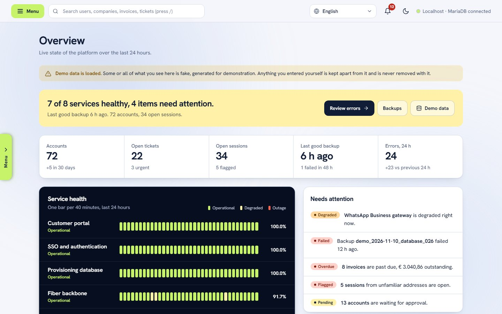
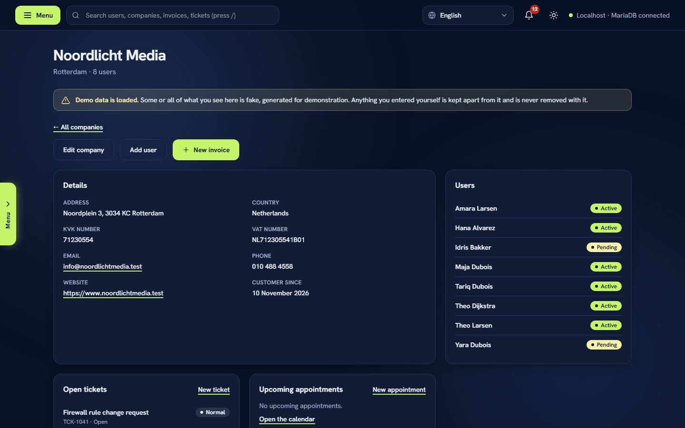
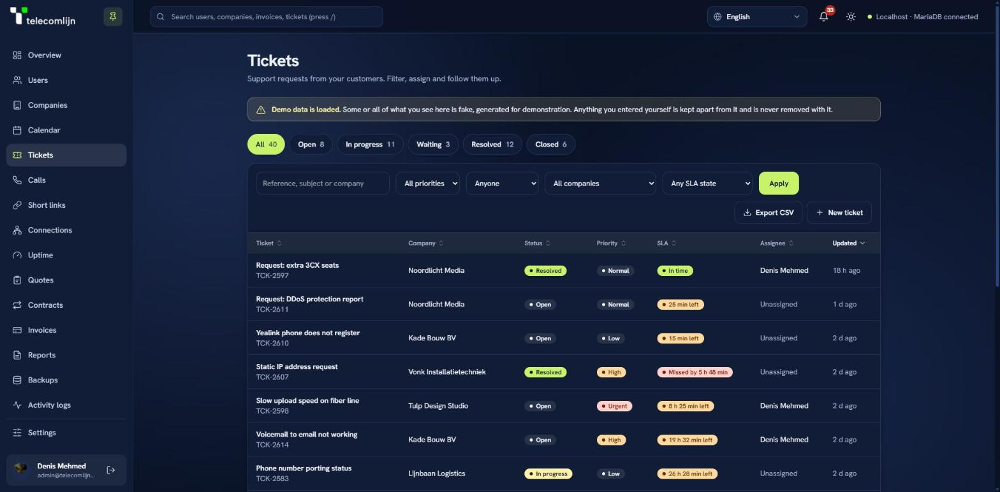
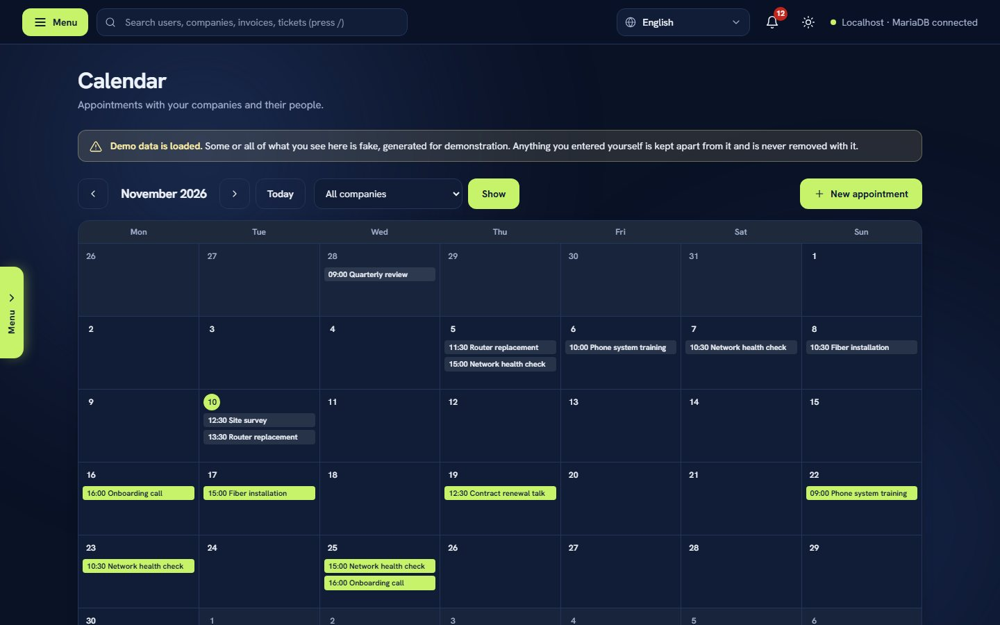
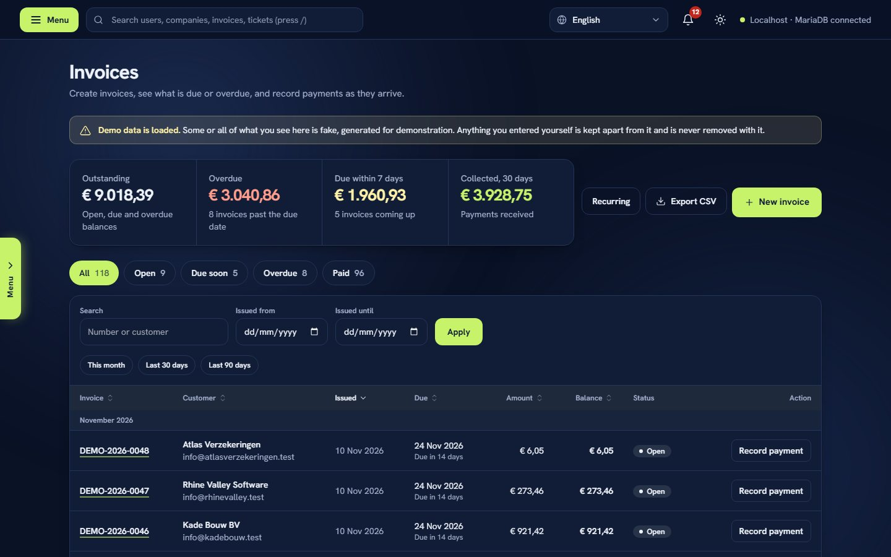
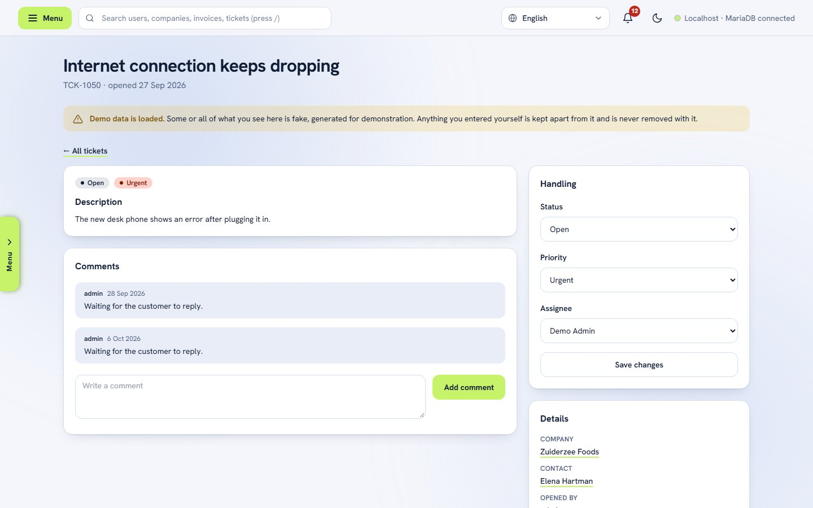
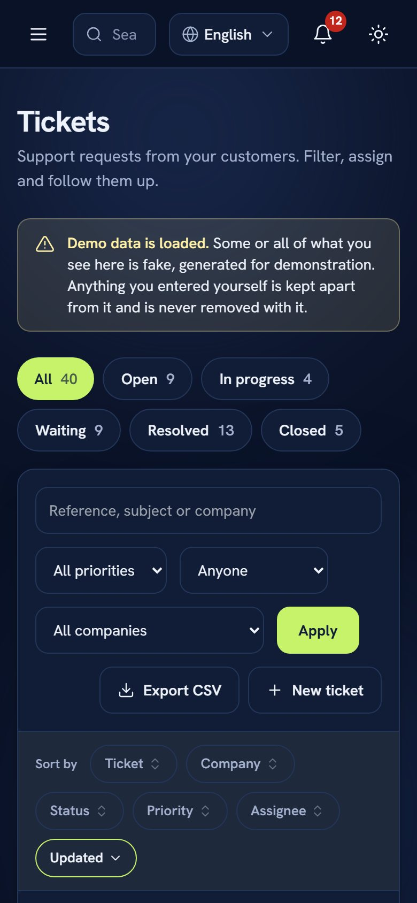
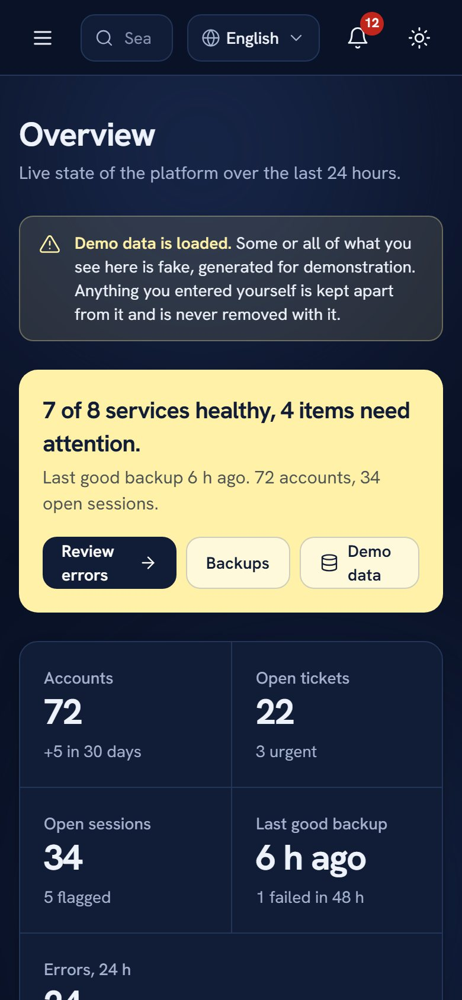

<picture>
  <source media="(prefers-color-scheme: dark)" srcset="assets/img/telecomlijn-logo-white.png">
  
</picture>

# Telecomlijn CRM

### One calm place to run a telecom business.
Customers, support, planning, invoices and uptime, together.

 

 

<picture>
  <source media="(prefers-color-scheme: dark)" srcset="docs/screenshots/overview-dark.jpg">
  
</picture>

The Overview, in light and dark mode. All data in the screenshots is generated demo data.

 

Telecomlijn CRM is a private CRM and operations dashboard for a business that sells and supports connectivity. It brings the people you serve, the problems they report, the visits you plan, the money you are owed and the health of your services into one fast, clear workspace. It runs on your own server, and your data stays there.

---

## What it does

<table>
<tr>
<td width="33%" valign="top">

### 🏢 Know your customers
Every customer is a **company** with its address, KvK and VAT numbers and the **people** who work there. One page shows their users, tickets, invoices, appointments and a full **timeline** of notes (call, meeting, email) and events.

</td>
<td width="33%" valign="top">

### 🎫 Handle support
**Tickets** with status, priority, owner and a comment thread. Filter by what is open, urgent or yours. Urgent tickets raise an alert and an email at once, and time-to-resolve is measured for you.

</td>
<td width="33%" valign="top">

### 📅 Plan the work
A **calendar** of appointments per company and contact person, as a month grid and an agenda. Click a day to plan a visit, and add any appointment to your own calendar app with one download.

</td>
</tr>
<tr>
<td valign="top">

### 💶 Get paid
Create **invoices** from a company in seconds, record payments, and see what is open, due soon or overdue. Download a clean **PDF**, and let **recurring invoices** bill monthly, quarterly or yearly, once per period and never twice.

</td>
<td valign="top">

### 📡 Watch your services
An **uptime** page in the style of Uptime Kuma, plus your own **endpoint checks**. A service that goes down tells you before a customer does.

</td>
<td valign="top">

### 📈 See the whole picture
The **Overview** shows health, key numbers and trends for revenue, new users, tickets and time to resolve, each with a data table. **Reports** and **activity logs** can be filtered and exported.

</td>
</tr>
<tr>
<td valign="top">

### 🔎 Find anything
One search box finds people, companies, invoices and tickets. **CSV export and import** move data in and out safely, and explain every row they refuse.

</td>
<td valign="top">

### 🔔 Stay informed
A **notification bell** for overdue invoices, failed backups, services that are down and urgent tickets, each mailed once to the address you choose and to colleagues who opt in.

</td>
<td valign="top">

### 👥 Run a team
Invite colleagues by email, set roles and permissions, turn on **two-step sign-in** (and require it for admins), reset a lost device, and follow an **audit trail** of who did what.

</td>
</tr>
</table>

---

## See it

<table>
<tr>
<td width="50%"> <b>A company</b>: details, people, tickets, appointments and history on one page.</td>
<td width="50%"> <b>Tickets</b>: filter by status, priority, owner and company.</td>
</tr>
<tr>
<td width="50%"> <b>Calendar</b>: a month grid and an agenda, with an .ics download.</td>
<td width="50%"> <b>Invoices</b>: what is open, due soon and overdue at a glance.</td>
</tr>
<tr>
<td width="50%"> <b>Light mode</b>: follows your system, switch any time.</td>
<td width="50%" align="center">  <b>On a phone</b>: tables become readable cards.</td>
</tr>
</table>

---

## Built to be trusted

<table>
<tr>
<td width="33%" valign="top">

### 🔒 Secure by default
Passwords are stored only as strong hashes. Sign-in has lockout and rate limits, sessions end when idle, forms resist forged requests, stored secrets are encrypted, and a strict content policy blocks injected scripts.

</td>
<td width="33%" valign="top">

### 🛡️ Privacy built in
Retention is automatic (logs after 12 months, invoices after the legal 7 years). Staff can look up, export and anonymise what is held about a person. Translation through Google happens only after explicit consent.

</td>
<td width="33%" valign="top">

### ♿ Accessible and responsive
Contrast measured in light and dark, charts with data tables, full keyboard use, and motion that stops for people who ask for less of it. On small screens tables turn into cards.

</td>
</tr>
</table>

An automated suite of **over 1,100 checks** (run on every push by GitHub Actions), including a crawler that follows every link and form in the program, runs against a real server. Every test and fix is documented inside the product, under *Settings → Tests*.

## Under the hood

PHP 8.2 and MariaDB with Tailwind CSS: no framework and no build step, on a plain XAMPP stack. Pages are grouped by feature (`auth`, `users`, `companies`, `tickets`, `calendar`, `invoices`, `monitoring`, `system`, ...), shared logic lives in `includes/`, and scheduled jobs in `bin/`. The PDF writer, the two-factor code (RFC 6238) and the SMTP client are written in-house, so customer data does not leave the server through third-party services.

## Documentation

| Read this | For |
| --- | --- |
| [`docs/SYSTEM_FEATURES_EXPLAINED.txt`](docs/SYSTEM_FEATURES_EXPLAINED.txt) | Every page and feature, how to use it, with worked examples |
| [`docs/SYSTEM_GUIDE_SECURITY_AND_COMPLIANCE.txt`](docs/SYSTEM_GUIDE_SECURITY_AND_COMPLIANCE.txt) | How each part is secured, how it supports the GDPR and Dutch rules, known gaps, go-live checklist |
| [`docs/INSTALL.md`](docs/INSTALL.md) | Setup, folder layout, scheduled jobs, tests, running on a network |
| [`docs/PRODUCT.md`](docs/PRODUCT.md) | Product and design notes |
| [`docs/datalekprocedure.md`](docs/datalekprocedure.md), [`docs/verwerkingsregister.md`](docs/verwerkingsregister.md) | Data-breach procedure and processing register (Dutch, drafts for legal review) |

 

**Design and development by Denis Mehmed for Telecomlijn.**

Copyright © 2026 Denis Mehmed. All rights reserved. No one may use, copy, modify or distribute this software without written permission. See [LICENSE](LICENSE).
Third-party components (Tailwind CSS, Hanken Grotesk, icon shapes) keep their own licences, listed in [`assets/LICENSES.txt`](assets/LICENSES.txt).

