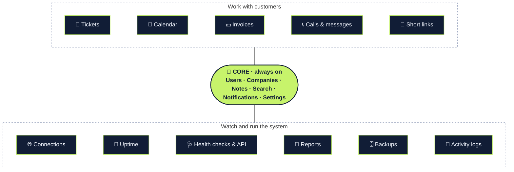

<div align="center">

<picture>
  <source media="(prefers-color-scheme: dark)" srcset="assets/img/telecomlijn-logo-white.png">
  
</picture>

# Telecomlijn CRM

### The CRM you switch on one module at a time.
Customers at the core. Tickets, calendar, invoices, calls, uptime and more as modules you turn on when you need them.

<br>


<br>

[**Modules**](#-built-from-modules) &nbsp;·&nbsp; [**The core**](#-the-core-always-on) &nbsp;·&nbsp; [**Screenshots**](#-see-it) &nbsp;·&nbsp; [**Trust**](#-built-to-be-trusted) &nbsp;·&nbsp; [**Get started**](#-get-started) &nbsp;·&nbsp; [**For developers**](#-for-developers) &nbsp;·&nbsp; [**Docs**](#-documentation)

<br>

<picture>
  <source media="(prefers-color-scheme: dark)" srcset="docs/screenshots/overview-dark.jpg">
  
</picture>

<sub>The Overview, in light and dark mode. All data in the screenshots is generated demo data.</sub>

</div>

<br>

Telecomlijn CRM is a private CRM and operations dashboard for a business that sells and supports connectivity. Not every business needs every part of it, so it is **built from modules**: a small core that knows your customers, and eleven features around it that each client turns on or off. A support desk can run only Tickets and Calendar. A reseller can add Invoices. A network team can add Uptime and Connections. It runs on your own server, and your data stays there.

<br>

## 🧩 Built from modules



<div align="center"><sub>Every dark box is a switch. Every module plugs into the core, and <b>no module needs another one</b>.</sub></div>

<br>

<table>
<tr>
<td width="25%" valign="top" align="center">

### 🎚️
**One switch each**<br>
<sub>An admin ticks a box under <i>Settings → Modules</i>. No install, no restart, no code.</sub>

</td>
<td width="25%" valign="top" align="center">

### 🧱
**Fully independent**<br>
<sub>Any combination works, from all eleven to none at all. Nothing breaks when a neighbour is off.</sub>

</td>
<td width="25%" valign="top" align="center">

### 💾
**Data is never lost**<br>
<sub>Off means hidden, not deleted. Turn a module on again and everything is back.</sub>

</td>
<td width="25%" valign="top" align="center">

### 🧹
**Gone means gone**<br>
<sub>No dead menu items, no empty panels. The pages rearrange themselves around what is on.</sub>

</td>
</tr>
</table>

### The modules

| | Module | What it gives you |
| :-: | --- | --- |
| 🎫 | **Tickets** | Support tickets with status, priority, owner and a comment thread. Urgent tickets raise an alert and an email at once, and time to resolve is measured for you. |
| 📅 | **Calendar** | Appointments per company and contact person, as a month grid and an agenda. Add any appointment to your own calendar app with one download. |
| 💶 | **Invoices** | Invoices from a company in seconds, payments, and what is open, due soon or overdue. Clean PDFs, and recurring invoices that bill once per period and never twice. |
| 📞 | **Calls & messages** | Calls and messages per customer from 3CX, Yeastar and Twilio. |
| 🔗 | **Short links** | Short links per company from Short.io. |
| 🌐 | **Connections** | The list of customer connections and their status. |
| 📡 | **Uptime** | An uptime page fed by Uptime Kuma. A service that goes down tells you before a customer does. |
| 🩺 | **Health checks & API** | Your own endpoint checks, a health API for other tools, and its API keys. |
| 📄 | **Reports** | Generated reports and their downloads. |
| 🗄️ | **Backups** | The backups page, with an alert when a backup fails. |
| 📜 | **Activity logs** | The page that shows the audit trail, with filters and export. Activity is still recorded while it is off. |

### What happens when you switch one off

| Where | What changes |
| --- | --- |
| **Menu and pages** | The menu item disappears and the module's pages answer "not available". |
| **Customer pages** | Its panel leaves the company and person pages, and its events leave the timeline. |
| **Overview** | Its tiles, charts and "needs attention" items leave, and the rest closes up. |
| **Search** | Its results are no longer searched or shown. |
| **Notifications and email** | Nothing new is raised, and older notices are hidden from the bell and the digest. |
| **Settings** | Its settings tab disappears (Kuma, Connectors, Integrations). |
| **Export** | Its CSV export is refused. |
| **Scheduled jobs** | Its job prints one line and stops, so a forgotten task does no harm. |
| **Your data** | **Untouched.** Switch it on again and it is all there. |

<br>

## 🏢 The core, always on

Everything else plugs into this, so it cannot be turned off.

<table>
<tr>
<td width="33%" valign="top">

### 🏢 Know your customers
Every customer is a **company** with its address, KvK and VAT numbers and the **people** who work there. One page per company and per person, with a full **timeline** of notes (call, meeting, email) and events.

</td>
<td width="33%" valign="top">

### 🔎 Find anything
One search box finds people and companies, plus the invoices and tickets of the modules that are on. **CSV export and import** move data in and out safely, and explain every row they refuse.

</td>
<td width="33%" valign="top">

### 🔔 Stay informed
A **notification bell** for what needs you, each notice mailed once to the address you choose and to colleagues who opt in. Only modules that are on can ring it.

</td>
</tr>
<tr>
<td valign="top">

### 📈 See the whole picture
The **Overview** shows key numbers, trends and what needs attention, each chart with a data table. It is built from the modules that are on, so it never shows an empty box.

</td>
<td valign="top">

### 👥 Run a team
Invite colleagues by email, set roles and permissions, turn on **two-step sign-in** (and require it for admins), and reset a lost device.

</td>
<td valign="top">

### 🎚️ Shape the product
**Settings → Modules** is where an admin decides what this install is. Every change is written to the audit trail.

</td>
</tr>
</table>

<br>

## 📸 See it

<table>
<tr>
<td width="50%"><br><sub><b>A company</b>: the core page. Each panel on it belongs to a module, and is only there when that module is on.</sub></td>
<td width="50%"><br><sub><b>Tickets module</b>: filter by status, priority, owner and company.</sub></td>
</tr>
<tr>
<td width="50%"><br><sub><b>Calendar module</b>: a month grid and an agenda, with an .ics download.</sub></td>
<td width="50%"><br><sub><b>Invoices module</b>: what is open, due soon and overdue at a glance.</sub></td>
</tr>
<tr>
<td width="50%"><br><sub><b>Light mode</b>: follows your system, switch any time.</sub></td>
<td width="50%" align="center"> <br><sub><b>On a phone</b>: tables become readable cards.</sub></td>
</tr>
</table>

<br>

## 🔐 Built to be trusted

<table>
<tr>
<td width="33%" valign="top">

### 🔒 Secure by default
Passwords are stored only as strong hashes. Sign-in has lockout and rate limits, sessions end when idle, forms resist forged requests, stored secrets are encrypted, and a strict content policy blocks injected scripts.

</td>
<td width="33%" valign="top">

### 🛡️ Privacy built in
Retention is automatic (logs after 12 months, invoices after the legal 7 years). Staff can look up, export and anonymise what is held about a person. Translation through Google happens only after explicit consent.

</td>
<td width="33%" valign="top">

### ♿ Accessible and responsive
Contrast measured in light and dark, charts with data tables, full keyboard use, and motion that stops for people who ask for less of it. On small screens tables turn into cards.

</td>
</tr>
</table>

An automated suite of **over 1,250 checks** (run on every push by GitHub Actions) runs against a real server. It includes a crawler that follows every link and form in the program, and it switches modules off, one at a time and all at once, to prove the rest keeps working. Every test and fix is documented inside the product, under *Settings → Tests*.

<br>

## 🚀 Get started

```
C:\xampp\php\php.exe bin\setup.php
```

1. **Install.** Put the project under `htdocs`, start Apache and MySQL, and run the line above. It creates the database and prints the first admin password once.
2. **Sign in** and choose your own password.
3. **Choose your modules** under *Settings → Modules*. A new install starts with everything on, so switch off what this client does not need.

The full guide, with scheduled jobs and updates, is in [`docs/INSTALL.md`](docs/INSTALL.md).

<br>

## 🛠 For developers

PHP 8.2 and MariaDB with Tailwind CSS: no framework, on a plain XAMPP stack. The stylesheet is compiled once with the Tailwind CLI and committed, so running the system needs no Node. The PDF writer, the two-factor code (RFC 6238) and the SMTP client are written in-house, so customer data does not leave the server through third-party services.

**One folder per module, one registry for all of them.** Each module keeps its pages in its own folder. `includes/core/modules.php` lists every module and the pages it owns:

```php
const MODULES = [
    'tickets' => ['label' => 'Tickets', 'desc' => 'Support tickets with status, priority, owner and comments.',
        'paths' => ['tickets/']],
    // ...
];
```

That entry closes the module's own pages when it is off and lists it under *Settings → Modules*. Where a module shows something on a shared page, one line guards it:

```php
<?php if (module_enabled('tickets')): ?>
  <?= tickets_panel($pdo, 'company_id', $id, 'tickets/ticket_new.php?company=' . $id) ?>
<?php endif; ?>
```

The state is one row per module in the database. No row means on, so adding a module needs no migration.

```
includes/core/      bootstrap, security, layout and the module registry (the core)
includes/modules/   the function library of each feature
includes/settings/  one file per Settings tab
tickets/  calendar/  invoices/  calls/  links/  monitoring/  system/     module pages
users/  companies/  search/  notifications/  settings/  auth/            core pages
bin/                scheduled jobs
tests/              the test suite
```

<br>

## 📚 Documentation

| Read this | For |
| --- | --- |
| [`docs/SYSTEM_FEATURES_EXPLAINED.txt`](docs/SYSTEM_FEATURES_EXPLAINED.txt) | Every page and feature, how to use it, with worked examples |
| [`docs/SYSTEM_GUIDE_SECURITY_AND_COMPLIANCE.txt`](docs/SYSTEM_GUIDE_SECURITY_AND_COMPLIANCE.txt) | How each part is secured, how it supports the GDPR and Dutch rules, known gaps, go-live checklist |
| [`docs/INSTALL.md`](docs/INSTALL.md) | Setup, choosing modules, folder layout, scheduled jobs, tests, running on a network |
| [`docs/PRODUCT.md`](docs/PRODUCT.md) | Product and design notes |
| [`docs/datalekprocedure.md`](docs/datalekprocedure.md), [`docs/verwerkingsregister.md`](docs/verwerkingsregister.md) | Data-breach procedure and processing register (Dutch, drafts for legal review) |

<br>

<div align="center">

**Design and development by Denis Mehmed for Telecomlijn.**

Copyright © 2026 Denis Mehmed. All rights reserved. No one may use, copy, modify or distribute this software without written permission. See [LICENSE](LICENSE).
Third-party components (Tailwind CSS, Hanken Grotesk, icon shapes) keep their own licences, listed in [`assets/LICENSES.txt`](assets/LICENSES.txt).

</div>
